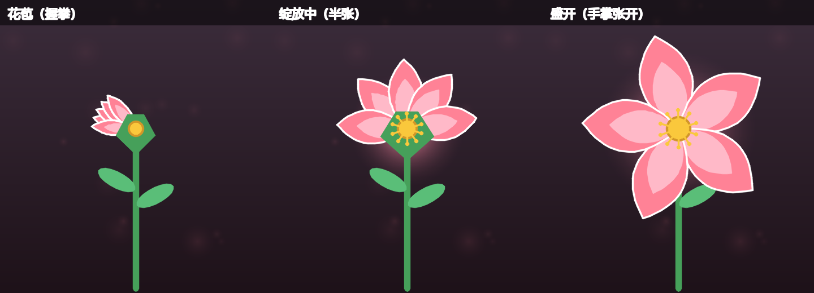

# 隔空手势动态交互系统 —— 五瓣花盛开

基于 **手部骨骼关键点检测** 的隔空手势交互系统：摄像头实时捕捉手部 21 个关键点，量化手部"伸展度"，经 **卡尔曼滤波/EMA 平滑** 后驱动 **五瓣花** 在屏幕上随你的手掌 **握拳收拢成花苞、张开尽情盛开**。

> 对应实训题目三：基于骨骼关键点检测的隔空手势动态交互系统（以"五瓣花盛开"为例）



## 功能亮点

| 功能 | 说明 |
|------|------|
| 手部 21 关键点实时检测 | MediaPipe Hands，骨骼连线贴合手部动作 |
| 手臂骨骼（可选） | 按 `P` 启用 MediaPipe Pose，绘制肩-肘-腕链路 |
| 手势量化映射 | 五指尖-掌心归一化距离 → 伸展度 0~1，握拳=花苞、张开=盛开 |
| 抖动消除（核心） | 一维**卡尔曼滤波**（默认）与 **EMA** 双算法可切换，`S` 键现场对比开关效果 |
| 缓动动画 | easeInOutCubic 驱动花瓣几何 + 弹簧-阻尼微过冲，绽放自然不生硬 |
| 运动轨迹 | 手部中心轨迹渐隐可视化，花茎随手部位置柔性摆动 |
| 双手交互（附加分） | 双手同屏 → 左右双花，每只手独立控制一朵的开合 |
| 捏合切换花色（附加分） | 拇指-食指捏合（或按 `C`）循环 4 种花色 |
| 花瓣粒子特效 | 完全盛开时花瓣随风飘落 |
| 性能监控 | 实时 FPS、端到端延迟显示；`--log` 导出逐帧 CSV 用于评估报告 |

## 环境安装

> **Windows 中文用户名注意**：MediaPipe 的 C++ 模块无法读取含中文字符的路径
> （如 `C:\Users\<中文名>\...`），会报 `FileNotFoundError: The path does not exist`。
> 因此请务必在 **纯英文路径** 下创建虚拟环境安装依赖：

```bash
# Python 3.8+（推荐 3.10 ~ 3.12），在项目目录执行：
python -m venv .venv
.venv\Scripts\activate                 # Windows
pip install -r requirements.txt
```

## 运行

```bash
python main.py                     # 默认摄像头 0
python main.py --camera 1          # 指定摄像头
python main.py --video test.mp4    # 离线视频测试（循环播放）
python main.py --smoother ema      # 指定平滑算法 kalman / ema / off
python main.py --pose              # 启用手臂姿态检测
python main.py --log stats.csv     # 逐帧记录性能数据（评估报告用）
```

### 操作说明

| 手势 / 按键 | 效果 |
|-------------|------|
| **握拳** | 花朵收拢为花苞 |
| **张开手掌** | 花朵逐渐盛开 |
| **移动手掌** | 花茎随手部位置柔性摆动 |
| **双手同屏** | 左右双花，左手控左花、右手控右花（每手独立平滑） |
| **拇指-食指捏合** | 切换花色 |
| `S` | 平滑 开/关（现场对比抖动差异） |
| `M` | 切换 卡尔曼 / EMA |
| `C` | 切换花色 |
| `P` | 手臂骨骼检测开关 |
| `H` | 帮助面板 |
| `Q` / `ESC` | 退出 |

## 项目结构（三层解耦）

```
gesture_flower/
├── main.py                # 入口：装配三层、主循环、按键控制
├── config.py              # 全局可调参数（阈值/滤波参数/动画参数）
├── vision/                # —— 视觉层 ——
│   ├── camera.py          #   摄像头后台线程（最新帧策略降延迟）
│   ├── hand_tracker.py    #   MediaPipe Hands 21 关键点
│   ├── pose_tracker.py    #   MediaPipe Pose 手臂骨骼（可选）
│   └── features.py        #   伸展度/捏合/中心点/双手间距 特征提取
├── logic/                 # —— 逻辑层 ——
│   ├── smoother.py        #   EMA / 一维卡尔曼 / 直通 + 抖动量化指标
│   ├── easing.py          #   缓动函数库 + 弹簧-阻尼数值动画
│   └── mapper.py          #   手势特征 -> 动画参数（bloom/位置/缩放）
├── render/                # —— 渲染层 ——
│   ├── flower.py          #   五瓣花绽放渲染（贝塞尔花瓣/花蕊/花萼/光晕）
│   ├── particles.py       #   飘落花瓣粒子系统
│   ├── ui.py              #   分屏 UI + 信息栏 + 帮助面板
│   └── text_cn.py         #   PIL 中文文本绘制
├── utils/stats.py         # FPS/延迟监控 + CSV 记录
├── scripts/
│   ├── evaluate_smooth.py # 平滑前后抖动对比评估（离线，输出图表）
│   └── render_states.py   # 离线渲染花朵三状态图
├── tests/test_all.py      # 单元测试（无需摄像头）
├── docs/                  # 评估报告、图表
└── requirements.txt
```

## 核心算法说明

### 1. 伸展度量化（vision/features.py）

```
掌径 palm      = dist(手腕#0, 中指根#9)                # 尺度归一化基准
伸展度原始值    = mean( dist(指尖#4/8/12/16/20, 手腕) ) / palm
伸展度 openness = clip(线性映射[0.72, 1.48] -> [0,1], 0, 1)
```

以掌径为基准归一化，使用户前后移动（成像大小变化）不影响特征稳定性。

### 2. 抖动消除（logic/smoother.py）

* **EMA**：`y_k = (1-α)·y_{k-1} + α·x_k`，α=0.35，O(1) 开销。
* **一维卡尔曼**（默认）：常值模型 `predict(P+=Q) -> update(K=P/(P+R))`，
  Q=2.5e-3 / R=4.0e-2，在跟手性与平滑度间可独立调参。
* 平滑前后客观对比见 `docs/性能评估报告.md`（帧间抖动降低约 78%）。

### 3. 绽放动画（render/flower.py）

* 花瓣 = 两条二次贝塞尔曲线构成的闭合轮廓；花瓣长度/宽度/张角由
  `easeInOutCubic(bloom)` 驱动：花苞时五瓣聚拢 ±16° 抱合，盛开时按 72° 均匀展开，展开顺序 1→2→3→4→0 形成层次感。
* 显示值经**弹簧-阻尼**二阶系统趋近平滑目标，带轻微过冲，杜绝生硬切换。

## 测试

```bash
python tests/test_all.py     # 9 项单元测试（平滑器/缓动/特征/映射/渲染）
```

## 性能评估

详见 [docs/性能评估报告.md](docs/性能评估报告.md)。核心实测数据：

* 抖动消除：合成手部信号帧间抖动降低 **55.6%**（纯噪声场景 **83.9%**），RMSE 优于 EMA 基准；
* 离线基准（300 帧）：单帧处理 **23.5 ms**（推理 13.5 + 渲染 10.1），处理上限 **~43 FPS**；
* 估算端到端延迟 ≈ **74 ms**（采集 ≤33 + 处理 24 + 显示 ≤17），满足 <100 ms 指标。

## 打包为可执行文件（产品化）

已提供 [GestureFlower.spec](GestureFlower.spec) 打包配置（onedir 模式，首启快、
运行稳定；保留控制台便于查看 FPS 日志与排障）：

```bash
.venv\Scripts\python.exe -m PyInstaller GestureFlower.spec --noconfirm
```

产物：`dist\GestureFlower\`（约 600 MB，含 mediapipe 模型与 OpenCV 运行库）。
**整个文件夹一起拷贝到目标机器**，双击其中的 `GestureFlower.exe` 即可运行，
无需安装 Python 环境。目标机器需要摄像头。

> 打包要点（踩坑记录）：
> 1. 必须 `collect_all("mediapipe")` 收集模型文件(.binarypb/.tflite)，否则运行时报
>    `FileNotFoundError: The path does not exist`；
> 2. **不能在 excludes 中排除 matplotlib** —— mediapipe.python.solutions.drawing_styles
>    隐式依赖它，否则启动即 `ModuleNotFoundError`；
> 3. mediapipe 不支持中文路径，exe 所在目录也必须为纯英文路径。

## 已知边界与改进方向

* 强逆光/极暗光下检测置信度下降 → 可自适应调节 `HAND_DET_CONF`（config.py）；
* 深肤色手部在低对比背景下偶有关键点漂移 → MediaPipe 模型侧限制，可换用
  YOLO-Pose/HRNet 高精度模型（接口已在 vision 层解耦，替换 HandTracker 即可）；
* 卡尔曼参数针对 30fps 调校，低帧率设备可按报告中的方法重新标定 Q/R。
